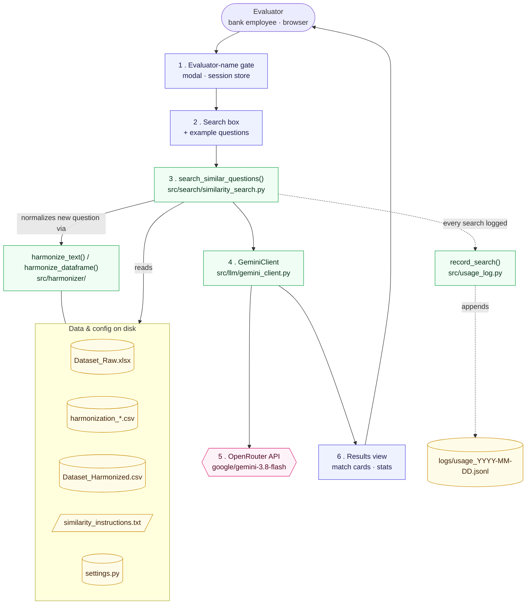

# Similar Question Search

**A component of the GenAI Model Performance Evaluation Framework (MEF), built for the Deutsche Bank industry project at SRH Heidelberg University.**

[](https://github.com/SRH-Heidelberg-University-ADSA/SimilaritySearch/actions/workflows/ci.yml)


---

## Table of contents

- [Overview](#overview)
- [Key features](#key-features)
- [Tech stack](#tech-stack)
- [Architecture](#architecture)
- [Project structure](#project-structure-what-every-file-is-for)
- [Getting started](#getting-started)
- [Configuration](#configuration)
- [Testing](#testing)
- [Editing how similarity is judged](#editing-how-similarity-is-judged)
- [Usage & audit logging](#usage--audit-logging)
- [Deployment](#deploying-docker--portainer-university-data-lab)
- [Trying it yourself](#trying-it-yourself-add-a-question-and-search-for-it)
- [Known test cases](#known-test-cases)
- [Roadmap / known limitations](#roadmap--known-limitations)
- [Cost & performance](#cost--performance)
- [Acknowledgments](#acknowledgments)

---

## Overview

Evaluating a GenAI model against a growing bank of historical
financial-analytics questions is expensive to do by hand. Every new
question an evaluator wants to ask has probably, in some form, already
been asked before, but finding that out today means scrolling through a
spreadsheet of hundreds of prior conversations and comparing divisions,
metrics, time periods and phrasing by eye. Similar Question Search
automates that lookup.

An evaluator types one question into a browser UI. That question, along
with the entire harmonized historical dataset, is sent to Gemini (via
OpenRouter) in a single API call. Gemini searches the whole dataset,
identifies genuinely similar earlier questions, even when the wording,
abbreviations or phrasing are completely different, and returns each one
with a conversation ID, a plain-language match label, and a similarity
score. The goal is to give evaluators (and eventually bank analysts)
instant visibility into whether a question has already been asked, which
cuts down duplicate evaluation effort and keeps scoring consistent across
a large question bank.

This is one component of the broader Model Performance Evaluation
Framework (MEF) built for the Deutsche Bank industry project. Other
components of the framework are out of scope for this repository.

## Key features

- **Natural-language search.** Evaluators type questions the way a real
  analyst would, using shorthand, abbreviations (CIR, ROE, WM, HNW) and
  the occasional typo. There's no query syntax to learn.
- **Deterministic terminology harmonization.** A rule-based pipeline
  normalizes both the historical dataset and every new question into
  consistent canonical terms before the model ever sees them, so matching
  quality doesn't depend on the LLM having to resolve abbreviations
  itself. See [Core design principle](#core-design-principle).
- **Plain-text, code-free scoring rules.** What counts as a "similar
  question" and how it's scored lives entirely in
  `instructions/similarity_instructions.txt`, a plain-English file, so
  tuning the scoring behaviour never requires a code change.
- **Evaluator attribution and an audit trail.** Every session is gated
  behind a name prompt, and every search, successful, empty, or failed,
  is logged with who ran it, what they asked, how long it took, and what
  came back.
- **Plain-language results UI.** Match strength is shown as words
  ("Near-identical question", not just "94%"), with short "why it
  matches" reason chips, built with Dash and Mantine Components.
- **Config-driven, not hardcoded.** Every path, column name, model
  setting, match-strength band and display cutoff lives in
  `config/settings.py`. Nothing environment- or deployment-specific is
  buried in application code.
- **Tested and CI-enforced.** A pytest suite (including two regression
  tests tied to real historical bugs, see [Testing](#testing)) and a ruff
  lint pass run automatically on every push and pull request.
- **Container-ready.** A hardened, non-root Dockerfile builds a
  frontend-only image suitable for the university's Data Lab deployment
  path, built and published automatically by CI.

## Tech stack

| Layer               | Technology                                                        |
|----------------------|--------------------------------------------------------------------|
| UI                  | [Dash](https://dash.plotly.com/) + [Dash Mantine Components](https://www.dash-mantine-components.com/) |
| Language model      | Google Gemini (`google/gemini-3.8-flash`), via [OpenRouter](https://openrouter.ai/) |
| Data handling       | pandas, openpyxl                                                    |
| Testing             | pytest, pytest-mock, pytest-cov                                     |
| Linting             | ruff                                                                 |
| Packaging           | pyproject.toml (PEP 621), with a synced `requirements.txt` for Docker |
| CI/CD               | GitHub Actions, publishing to GitHub Container Registry (ghcr.io)    |
| Containerization    | Docker (non-root, health-checked), deployed via Portainer            |
| Runtime             | Python 3.11+                                                        |

## Architecture



A static copy of this diagram is also kept at `architecture.mmd`
(Mermaid source) and `architecture_diagram.png` (rendered PNG), for
viewers that don't render Mermaid inline.

**Request flow:**

1. On first load, the evaluator has to enter their name in a modal before
   anything else is usable (`evaluator_gate()` in `app.py`). This name is
   attached to every search they run, for the audit log.
2. They type a question in their own words, or click a one-click example.
3. `search_similar_questions()` (`src/search/similarity_search.py`)
   re-harmonizes the historical dataset, normalizes the new question
   through the same harmonizer, and formats the historical rows as plain
   text for the model prompt.
4. `GeminiClient` (`src/llm/gemini_client.py`) sends the new question
   plus the entire formatted dataset to Gemini, via OpenRouter, in a
   single call. There's no chunking and no local pre-filtering of
   candidates.
5. Gemini returns every genuine match it finds, each with a conversation
   ID, question number, similarity score (0 to 1) and a short
   natural-language reason.
6. The UI renders each match as a card: score, plain-language label (e.g.
   "Same question, minor differences"), and "why it matches" tags,
   showing the raw original question text rather than the harmonized
   text Gemini actually compared against.
7. `record_search()` (`src/usage_log.py`) appends one audit record to
   `logs/usage_<date>.jsonl`: evaluator, question, elapsed time, and the
   matches returned (or the error, if the search failed).

### Core design principle

Gemini does all the interpretation. The code does none of it. It loads
the raw harmonized data and formats it as plain text for the prompt; it
doesn't merge, clean or pre-process anything beyond terminology
harmonization. Recognizing patterns in the data, including the fact that
some questions are split across two consecutive rows, is entirely
Gemini's job, guided by the plain-text instructions in
`instructions/similarity_instructions.txt`. This keeps the scoring logic
editable by a non-engineer (see
[Editing how similarity is judged](#editing-how-similarity-is-judged))
without ever touching Python.

The one piece of deterministic pre-processing that does happen in code
is harmonization. Both the historical dataset and the evaluator's new
question are run through the same alias-to-canonical dictionary before
comparison, so Gemini is comparing text that already uses consistent
terminology ("CIR", "cost/income ratio" and "cost-to-income ratio" all
become "Cost-Income Ratio") rather than having to resolve abbreviations
itself.

## Project structure: what every file is for

```
├── app.py                          <- UI: Dash + Mantine Components. The ONLY UI layer;
│                                       all matching logic lives in src/search/.
├── pyproject.toml                  <- project metadata + dependencies (source of truth for
│                                       local/dev installs: `pip install -e ".[dev]"`)
├── requirements.txt                <- flat dependency list, kept in sync with pyproject.toml,
│                                       used by the Dockerfile for a fast plain `pip install`
├── conftest.py                     <- empty; anchors pytest's import path at the project root
├── Dockerfile                      <- Frontend-only container (see Deployment)
├── .dockerignore                   <- keeps secrets/dev files/generated data out of the image
├── .gitignore
├── .env.example                    <- copy to .env and fill in your real values
├── README.md
├── architecture.mmd                <- Mermaid source for the diagram above
├── architecture_diagram.png        <- rendered copy, for viewers that don't render Mermaid
│
├── .github/
│   └── workflows/
│       └── ci.yml                  <- on every push/PR: install, lint (ruff), test (pytest);
│                                       on push to main: also builds + pushes the Docker
│                                       image to ghcr.io
│
├── config/
│   └── settings.py                 <- single source of truth for every path, column name,
│                                       and tunable setting. Nothing else should hardcode a
│                                       path, column name, or magic number that belongs here.
│
├── data/
│   ├── Dataset_Raw.xlsx            <- the historical Q&A dataset (raw, un-harmonized)
│   ├── harmonization_entities.csv  <- alias -> canonical dictionary (divisions, metrics, ...)
│   └── harmonization_time_formats.csv  <- alias -> canonical dictionary for dates/periods
│
├── instructions/
│   └── similarity_instructions.txt <- the FULL instruction Gemini receives for judging
│                                       similarity and producing a score. Edit this, not
│                                       code, to change what counts as "similar".
│
├── outputs/                        <- generated by the harmonizer; regenerated automatically
│   │                                   on app startup and before every search
│   ├── Dataset_Harmonized.csv      <- what the live search actually reads from
│   └── dataset_harmonization_qa_report.txt  <- human-readable summary of every substitution
│                                       made, for sanity-checking a harmonizer/dictionary change
│
├── logs/                           <- usage/audit trail; see Usage & audit logging
│   └── usage_YYYY-MM-DD.jsonl
│
├── src/
│   ├── logging_config.py           <- one place to turn on consistently-formatted logging,
│   │                                   called from app.py and from the harmonizer's own
│   │                                   entry point so a standalone run is also readable
│   ├── usage_log.py                <- record_search() / get_last_used(); appends one JSON
│   │                                   line per search to logs/usage_<date>.jsonl
│   ├── harmonizer/
│   │   ├── __init__.py             <- the "application": knows about this project's actual
│   │   │                               file paths; exposes run_harmonization_raw()
│   │   └── harmonizer.py           <- the "library": pure, file-path-agnostic functions
│   │                                   (load_dictionaries, build_alias_map, compile_patterns,
│   │                                   harmonize_text, harmonize_dataframe, write_qa_report)
│   ├── llm/
│   │   └── gemini_client.py        <- GeminiClient: the OpenRouter/Gemini API wrapper
│   │                                   (transport fallback, rate limiting, retry/backoff,
│   │                                   strict JSON-schema response parsing)
│   └── search/
│       └── similarity_search.py    <- search_similar_questions(): loads data, normalizes
│                                       the new question, calls Gemini, returns clean matches
│
└── tests/
    ├── test_harmonizer.py          <- unit tests + regression tests against the real CSV
    ├── test_gemini_client.py       <- response parsing + retry/backoff, no real API calls
    └── test_similarity_search.py   <- wiring tests with a fake dataset + fake Gemini client
```

## Getting started

### Prerequisites

- Python 3.11 or later (`python --version` to check)
- An OpenRouter API key ([openrouter.ai/keys](https://openrouter.ai/keys)); see the note below on why this is called `GEMINI_API_KEY`

### Quick start

```bash
git clone https://github.com/SRH-Heidelberg-University-ADSA/SimilaritySearch.git
cd SimilaritySearch
pip install -e ".[dev]"
cp .env.example .env
# edit .env and set GEMINI_API_KEY to your real OpenRouter key
python app.py
```

Then open <http://127.0.0.1:8050>, enter your name at the prompt, and
either type a question or click one of the example buttons.

### Detailed setup

```bash
git clone https://github.com/SRH-Heidelberg-University-ADSA/SimilaritySearch.git
cd SimilaritySearch

# Editable install with dev/test extras (pytest, ruff, ...):
pip install -e ".[dev]"
# -- or, for a plain runtime install without dev tools:
# pip install -r requirements.txt

cp .env.example .env
# edit .env and set GEMINI_API_KEY -- see the note below on what this key actually is
```

> **`GEMINI_API_KEY` is actually your OpenRouter key**, not a Google AI
> Studio key. The model (`google/gemini-3.8-flash`, see
> `config.settings.GEMINI_MODEL`) is routed through
> [OpenRouter](https://openrouter.ai/keys) rather than called directly.
> See `src/llm/gemini_client.py`'s module docstring for why.

You don't need to run the harmonizer separately first. `app.py` runs it
automatically on startup if `outputs/Dataset_Harmonized.csv` doesn't
exist yet, and `search_similar_questions()` re-runs it before every
search so edits to `data/Dataset_Raw.xlsx` or the harmonization
dictionaries are picked up immediately, without a restart. To run it
manually, for example just to inspect the QA report without starting the
UI:

```bash
python -c "from src.harmonizer import run_harmonization_raw; run_harmonization_raw()"
```

## Configuration

Every tunable value lives in `config/settings.py`, sourced from
environment variables where relevant. Nothing else in the codebase should
hardcode a path, column name, or magic number that belongs there.

| Variable          | Required | Default       | Meaning                                                              |
|--------------------|:--------:|---------------|------------------------------------------------------------------------|
| `GEMINI_API_KEY`   |   Yes    | none          | Your OpenRouter API key (see note above).                              |
| `DASH_HOST`        |    No    | `127.0.0.1`   | Bind address. The Dockerfile sets this to `0.0.0.0` for containers.    |
| `DASH_PORT`        |    No    | `8050`        | Port the Dash server listens on.                                       |
| `DASH_DEBUG`       |    No    | `0`           | Set to `1` to show Dash's developer toolbar.                           |
| `DASH_NO_BROWSER`  |    No    | `0`           | Set to `1` to skip auto-opening a browser tab (set to `1` in Docker).  |
| `LOG_LEVEL`        |    No    | `INFO`        | `DEBUG` / `INFO` / `WARNING` / `ERROR` / `CRITICAL`.                    |

## Testing

```bash
pip install -e ".[dev]"
pytest -q                                                     # run the suite
pytest -q --cov=src --cov=config --cov-report=term-missing    # with coverage
ruff check .                                                  # lint
```

Expected output:

```
23 passed in ~2s
All checks passed!
```

The suite covers three things in particular, because each one has broken
silently before in this exact project:

- **`tests/test_harmonizer.py`**: unit tests for the alias-matching logic
  itself (the case-sensitivity bug that once turned "cost-income ratio"
  into "cost-Revenue ratio", longest-alias-wins, the duplicate-canonical
  guard), plus two regression tests that load the real
  `data/harmonization_entities.csv`. Those two exist because the
  underlying bugs were fixed once in the data file, then silently
  reintroduced when the CSV was later expanded from an older base copy.
  A unit test alone wouldn't catch that, because the bug lived in the
  data rather than the code. If either regression test fails, someone
  has replaced `harmonization_entities.csv` with a copy that's missing
  these fixes.
- **`tests/test_gemini_client.py`**: response parsing (including the
  "reply looks truncated" error path) and the retry/backoff loop, with
  the actual API call point (`GeminiClient._call`) monkeypatched out, so
  these never make a real network call and never depend on which
  transport (the `openai` package vs. plain `requests`) happens to be
  active in a given environment.
- **`tests/test_similarity_search.py`**: wiring tests (raw-text lookup,
  score sorting, malformed-match filtering) against a small fixed
  dataset and a fake Gemini client, so they run fast and don't depend on
  the real data files or a real API call.

CI (`.github/workflows/ci.yml`) runs `ruff check .` and the full test
suite on every push and pull request, and won't build or publish the
Docker image unless both pass.

## Editing how similarity is judged

Open `instructions/similarity_instructions.txt` in any text editor. This
is the complete instruction Gemini receives, and no code changes are
needed to adjust what counts as "similar" or how it's scored. That's a
deliberate design choice (see
[Core design principle](#core-design-principle)) so the scoring
behaviour can be tuned by anyone comfortable editing plain English, not
only by a developer.

> **Keep this in sync with `config.settings.MATCH_DISPLAY_FLOOR`.** The
> UI shows a caption ("Only matches of X% or more are shown") built from
> `MATCH_DISPLAY_FLOOR`. That constant doesn't itself change Gemini's
> behaviour, it only describes, in the UI, whatever cutoff this
> instructions file actually asks Gemini to apply. If you change the
> cutoff here, update `MATCH_DISPLAY_FLOOR` in `config/settings.py` too,
> or the caption will describe a cutoff the model isn't really using.

## Usage & audit logging

Every search, successful, empty-result, or failed, is appended as one
line of JSON to `logs/usage_<YYYY-MM-DD>.jsonl` (`src/usage_log.py`).
Logging failures never break a search for the evaluator: if the log file
can't be written, a warning is logged and the search result is still
returned to the UI.

Example record:

```json
{
  "timestamp_utc": "2026-09-26T14:03:11+00:00",
  "evaluator": "Vinay",
  "question": "qtrs 25 give me cost and revenue for Wealth Management",
  "elapsed_seconds": 4.12,
  "match_count": 2,
  "matches": [
    {"conversation_id": "C4", "question_number": "Q1", "similarity_score": 0.95, "...": "..."}
  ],
  "error": null
}
```

`logs/` and `outputs/*.csv` / `outputs/*.txt` are intentionally not
git-ignored in this submission. The committed files are kept as evidence
that the harmonization pipeline and the audit-logging feature work end
to end, for this project's academic review. See the comment in
`.gitignore` for how to re-exclude them, for example before a real bank
deployment, where a fresh install should start with empty logs.

## Deploying (Docker / Portainer, university Data Lab)

This app calls out to OpenRouter for all model inference and does no
local GPU work, so per the university's "App deployment for Case Study
projects" guide it only needs the Frontend / Non-GPU path: one Docker
container running this Dash app, deployed to Portainer. No Backend
notebook, GPU, or LocalTunnel / Cloudflare Tunnel is needed.

**1. CI builds and pushes the image automatically.** On every push to
`main` that passes lint and tests, `.github/workflows/ci.yml` builds the
image from the `Dockerfile` and pushes it to GitHub Container Registry
at:

```
ghcr.io/srh-heidelberg-university-adsa/similaritysearch:latest
ghcr.io/srh-heidelberg-university-adsa/similaritysearch:<commit-sha>
(all lowercase, since GHCR requires it; check your repo's "Packages" tab
on GitHub to confirm the exact pushed reference after the first CI run)
```

This repository is private, so the pushed image is private too.
Portainer's "Docker Hub (anonymous)" registry option, the default shown
in the deployment guide's screenshots, can't pull it. Add ghcr.io as a
custom registry in Portainer instead:

- Portainer → **Registries** → **Add registry** → **Custom registry**
- URL: `ghcr.io`
- Username: your GitHub username
- Password: a GitHub personal access token with the `read:packages`
  scope (Settings → Developer settings → Personal access tokens)

**2. Create the container** (Portainer → **local** environment →
**Containers** → **+ Add container**):

| Field                                            | Value                                                          |
|----------------------------------------------------|------------------------------------------------------------------|
| Name                                              | e.g. `similar-question-search`                                   |
| Registry                                          | the ghcr.io custom registry added in step 1                      |
| Image                                             | `ghcr.io/srh-heidelberg-university-adsa/similaritysearch:latest` |
| Publish all exposed ports to random host ports    | On (maps the container's `8050` to a random public port)         |
| Access control                                    | Restricted, so teammates can also manage and restart it          |

**3. Before deploying, set the environment variable** (Advanced
container settings → **Env** tab → **Add an environment variable**, or
**Load variables from .env file**):

```
GEMINI_API_KEY=<the real OpenRouter key, never baked into the image, never committed>
```

This is the only place the real key should exist in this whole
deployment. `.dockerignore` already excludes `.env` from the image, and
`.gitignore` excludes it from the repository.

**4. Persist logs and outputs across restarts** (Advanced container
settings → **Volumes** tab). Without this, the container filesystem, and
the audit log it holds, is wiped on every restart or redeploy:

| Container path   | Host path (example)                                                |
|--------------------|-----------------------------------------------------------------------|
| `/app/logs`       | a persistent folder on the Data Lab host, e.g. `/data/similar-question-search/logs` |
| `/app/outputs`    | e.g. `/data/similar-question-search/outputs`                          |

The container runs as an unprivileged user with UID/GID `1000` (see the
`Dockerfile`). If the mounted host folders show permission errors, either
`chown` them to UID `1000` on the host, or ask the Data Lab admin how
volume ownership is handled on that server.

**5. Deploy, then find the public port.** Click **Deploy the container**;
in the container list, scroll right to **Published Ports** to find the
mapped host port, click it to confirm the app loads, then pick a
subdomain (e.g. `similar-question-search.app.data-lab.site`) and send it
with the port number to Prof. Vu for confirmation, per the university's
deployment guide.

## Trying it yourself: add a question and search for it

The fastest way to convince yourself, or a reviewer, that harmonization
and matching actually work end to end, without waiting on someone else's
question, is to add your own row to the dataset and then search for it
using completely different wording.

1. **Add a row.** Open `data/Dataset_Raw.xlsx` in Excel and add a new row
   at the bottom:

   | Conversation_ID | Type   | Conversation                                              |
   |------------------|--------|------------------------------------------------------------|
   | `C900` (any unused ID) | `user` | `cost income ratio for Corporate Banking Q2 25 pls` |

   Save and close the file. You don't need to run the harmonizer
   manually; `search_similar_questions()` re-harmonizes the dataset
   automatically before every search, so the new row is picked up
   immediately.

2. **Search for it, worded differently.** With the app running
   (`python app.py`), type a reworded version of the same question into
   the search box, for example:

   > what's the CIR for corporate banking in the second quarter of 2025

3. **Check the result.** The row you just added should come back as a
   high-scoring match, typically 85% or higher, with the "why it
   matches" reasoning naming the metric, division and period it
   recognized as equivalent.

To stress-test it further, reword the search question even more
aggressively: swap every abbreviation for its full name and reorder the
sentence completely. For example, a dataset row reading

> `AUM and CIR trend for HNW and WM combined H1 26`

should still be found by a search worded as

> looking at private banking and wealth management together for the
> first half of 2026, hows assets under management doing next to the
> cost to income ratio

despite sharing almost no words in common with the original. If a match
still comes back with a sensible score and reasoning, harmonization and
the Gemini matching step are both working correctly.

## Known test cases

Verified by hand against this dataset. Use these to sanity-check the
tool once it's running (also covered at the wiring level by
`tests/test_similarity_search.py`, against a fake dataset):

**Test 1**, should return C4, C34, C64:
> For Q1 2026, how do CB, Markets, Asset Management, and HNW compare when
> it comes to equity returns? Also, does the Cost-to-Income ratio for any
> of these divisions look out of line with where they rank on Return on
> Equity?

**Test 2**, should return C9, C39, C69:
> Can you compare PB, Transaction and Corporate Banking, Global Banking,
> and Consumer Banking for 4th Q 25 based on revenue, equity return, and
> CIR? Which one looks strongest overall?

## Roadmap / known limitations

- **`data/Dataset_Raw.xlsx` ships inside the repo/image as-is.** This is
  a deliberate project decision, so anyone pulling the repo can run the
  tool immediately without sourcing the dataset separately.
- **The current `.env` / API key is a placeholder value**, kept as-is for
  this submission. Before any deployment with live traffic, generate a
  real key on OpenRouter's dashboard and set it only via `.env` (local)
  or Portainer's Env tab (deployed); never commit it.
- **No automated CI-to-Portainer deployment step yet.** The Docker image
  is built and published automatically, but the container itself still
  needs to be created or updated by hand in Portainer per the steps
  above. A follow-up could add a Portainer webhook so a push to `main`
  also triggers a redeploy.
- **Full-dataset search, not chunked.** Every search sends the entire
  historical dataset to Gemini in one call rather than several smaller
  batches, by deliberate project decision. This is cheaper (one request
  per search) but was found less exhaustive at checking every candidate
  row than an earlier chunked approach. See
  `src/search/similarity_search.py`'s module docstring if this trade-off
  ever needs revisiting.

## Cost & performance

One search means one Gemini call carrying the full dataset as context
(around 10,000 tokens). That's comfortably within free-tier OpenRouter
limits and trivial in cost on a paid-tier key. Observed end-to-end
latency, from typing a question to seeing results, is typically in the
single-digit seconds, depending on OpenRouter's current load and dataset
size.

## Acknowledgments

- SRH Heidelberg University, ADSA, for project supervision
- Deutsche Bank, for the industry project context and historical dataset
- [OpenRouter](https://openrouter.ai/) and Google Gemini, the underlying language model
- [Plotly Dash](https://dash.plotly.com/) and [Dash Mantine Components](https://www.dash-mantine-components.com/), the UI framework

---

*This project is submitted as part of an academic industry project at SRH Heidelberg University. Not licensed for external distribution.*
